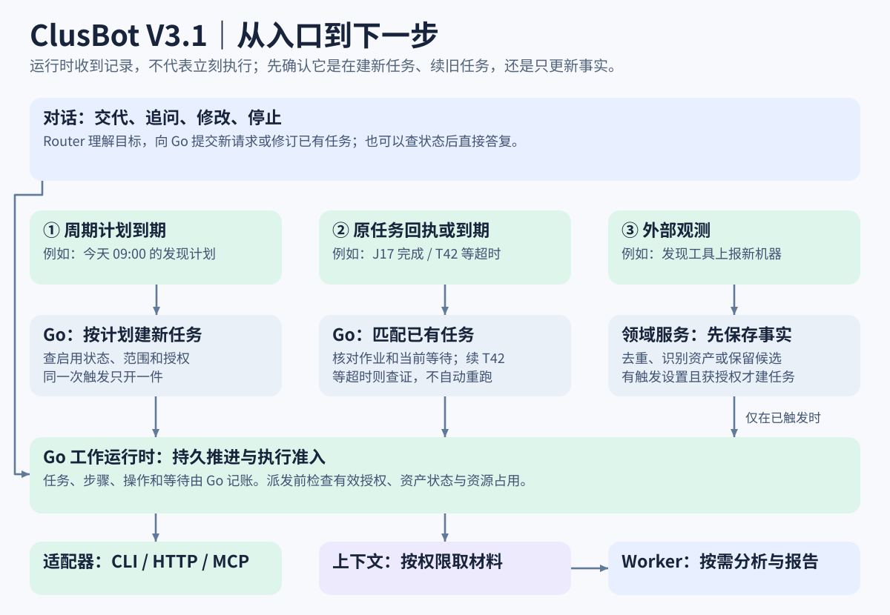
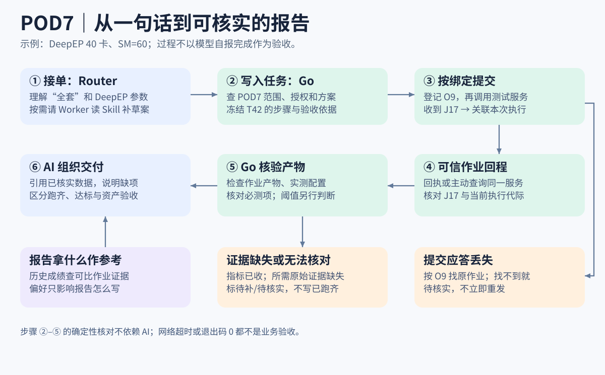
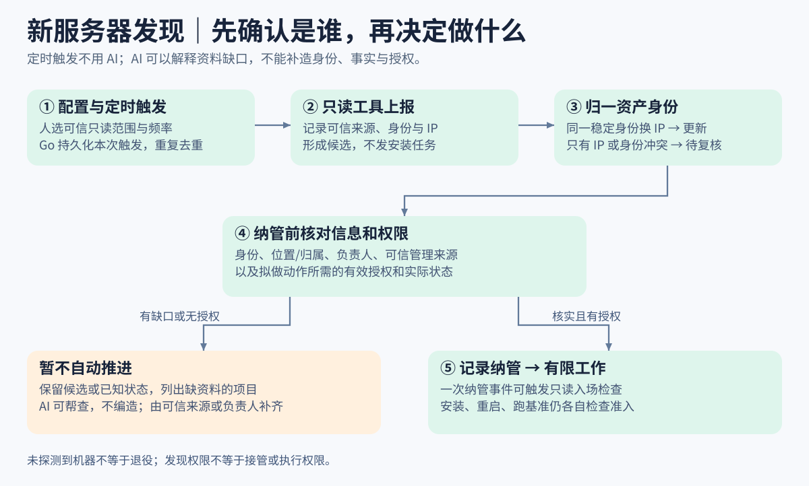

# ClusBot V3.1：个人助手如何把事情办完

**这是现行目标设计，不是已实现功能清单。** V3.1 沿用 V3 的个人助手、工作运行时和集群领域服务，补清三者怎样交换信息、怎样接入现场工具，以及什么证据才算做完。文中的字段、工具名、界面与配置均为设计示例，除非明确标注「现有」。现有能力及差距见末节。

## 1. 先看全局：谁决定，谁执行，谁记账

你在对话里交代事情、追问、调整或停止；助手负责排步骤、协调工具、跟进结果，按授权推进，不每步来问你。只有目标有实质歧义、动作超出授权或缺少必要材料时，才说明卡在哪里、需要谁补什么。工作台是查全局和追溯证据的地方，不是使用助手的必经入口。



| 部件 | 负责什么 | 不负责什么 |
| --- | --- | --- |
| 对话受理（Router，可用 AI） | 理解目标、区分新任务与已有任务的追问/修改，读出约束，提出结构化请求 | 不直接发集群命令，不判断作业完成 |
| 工作者（Worker，可用 AI） | 在当前任务范围内查资料、补计划、提出工具调用、解释异常、写报告 | 不发授权，不直接写验收状态 |
| 工作运行时（Go） | 接单、保存步骤、检查依赖和授权、派发、等待与恢复；管理任务进度 | 不靠提示词判断回执或验收，也不独占资产业务状态 |
| 集群领域服务 | 维护资产、拓扑、借用、故障与验收；提供可核对的事实和领域判定 | 不调度任务，不把“作业成功”直接写成“资产可交付” |
| 执行网关和工具适配器 | 检查调用、转换参数，接通内置函数、CLI、HTTP 或 MCP，收集可核实的结果 | 工具描述不是授权，适配器不替模型决定用户意图 |
| 上下文组装器 | 为当前 Router 或 Worker 取实际需要的材料，记录来源和缺口 | 不是任务库、资产库或授权表 |

这些是代码职责，不要求分成六个进程。单机先用 SQLite 和文件产物库；任务能后台推进，不等于服务关机后仍能运行。持久记录保证重启后能接着查和等，服务在线才会执行。

### 不经过对话的三种入口

**进入运行时只表示有一条待处理记录，不等于新建任务，也不授予权限。** 三路可共用收件箱、去重和审计，但要按类别分开处理：

| 收到了什么 | Go 查哪条记录 | 处理结果 |
| --- | --- | --- |
| 周期计划到期，例如今天 09:00 发现服务器 | 查计划版本、运行身份、批准范围；复核是否仍启用、是否已处理该计划时点 | 建一次有限发现任务。发现完可结束，不必等候选纳管 |
| 原任务回执或等待到期，例如 J17 完成 | 查可信连接、作业关联、当前执行代际和 Wait 版本 | 匹配才续 T42，不建新任务；超时进入对账，不宣布 J17 失败，也不自动重跑 |
| 外部观测，例如发现一台机器 | 查来源、资产身份与领域事实；满足条件后再查已发布的触发配置与授权 | 先记观测或候选；确认纳管后，有配置且有权才建只读检查任务，否则不继续 |

三路都不经 Router，也不默认调用模型。**定时器只报时，工具只供数；Go 在派发前还要复核授权和现场状态。** 处理分支、恢复与故障验收见[运行时触发与回执](运行时触发与回执.md)。

## 2. 刚安装好，如何从零接入 POD7

空环境可以对话，但**没有权威的 POD7 资产范围、运行权限和测试服务，就不能运行完整集群基准**。第一回由有权限的操作者接一次，后续用对话直接下单。下面是目标交互，不是现版菜单承诺。

1. **资产**：在「资产」导入或接入可信资产源，核对 POD7 的稳定 ID、节点成员、卡与拓扑、管理端点映射、负责人。模型可以帮搜别名；领域服务得确认它映射到哪组对象。IP 不是资产身份，发现的候选也不自动成为可操作资产。已有健康、占用记录要标明来源和时间，派发前必要时刷新。
2. **工具**：在「工具与连接」接入一个实际能跑集群测试的服务。先看形参、生命周期和输出：能否按范围启动、查询、取结果、取消？按作业还是按节点？实际会返回什么？在获准的受控样本中验证一次。从已接入的具体工具选择绑定；不能只因为服务名称带 Cluskit2 就认为全套能力都存在。
3. **Skill 和测试方案**：可以导入现有 Skill，让 AI 学习怎么跑、怎么看。也可以在对话里说“全套要跑单机带宽、集合通信、DeepEP，最后按这三项汇报”。助手展示「保存为测试方案」草稿，列出必测项、依赖、输入、能力绑定、验收证据。人可在卡里修改或继续用对话修改，发布成版本。没有 Skill 但已有明确方案和绑定，也能执行；只有 Skill 则能辅助规划，不能凭它冒充可自动验收的方案。
4. **执行授权**：确认主体、资产范围、允许动作和参数边界、占用窗口及并发限制。可长期委托限定范围；改变范围或扩大权限单独处理。方案发布不会自动授权，接上工具也不会授权。
5. **接入预检**：检查必测项是否都有可用绑定；长作业能否恢复查证；现有返回能否核对达标条件。对每项标「可自动核验」「需人工核验」「未接通」。不让一个存不了证据的绑定伪装成全自动。

用户不给定复用需求时，不必先发布永久方案：AI 可以为单次任务提出有限的步骤，Go 用同样的参数、权限与绑定检查接单。没有匹配工具的步骤要显示缺口，不能降级成随意执行命令。普通写报告或整理材料也用同一运行时，只是不需要 POD7 资源定义。

## 3. 用户的话怎么变成 Go 能执行的东西

> 在 POD7 跑一遍完整基准。DeepEP 用 40 卡、SM=60。汇总性能数据给我做报告；跟上次差得多就解释一下。

Router 拆成目标、步骤约束和交付；“全套”由已发布方案解释，缺方案且意义不清时，规划 Worker 可读 Skill 提出清单。40 卡和 SM=60 只约束 DeepEP，不推给其他项。“解释差异”是报告任务；没有定义“上次”筛选口径和阈值时，不转成通过线。

| 用户看见的东西 | 保存位置与形式 | 谁实际使用 |
| --- | --- | --- |
| “报告先讲结论，解释异常” | 任务交付说明；长期偏好可另存为记忆 | 报告 Worker 的提示词 |
| “DeepEP 40 卡、SM=60” | 本次任务的具体步骤参数 | Go 校验、填工具参数并核对实际执行；需要时也给 Worker 看 |
| “三项都跑齐才算完整” | 方案版本的必测项与证据条件 | Go 检查，AI 可预先知道怎样准备 |
| “此测试只在指定窗口占用 POD7” | 结构化执行授权和调度约束 | Go 派发前查有效授权、抢占资源租约 |
| “每天在已批准范围发现新机器” | 独立的有版本定时触发配置 | Go 的计时唤醒，不用模型读提示词 |

这些东西不应打包成一个通用的自由文本 Rule。任务的执行事实属于运行时 Go；验收或资源状态的确定性判定可以由它调用领域服务。下面是逻辑数据，**不是当前 API 或可直接导入的文件**：

```json
{
  "task": "T42",
  "revision": 1,
  "origin_message": "M18",
  "asset_scope": {"group": "pod-7", "membership_revision": "r18"},
  "profile": "full-benchmark@4",
  "precheck": {"id": "precheck", "checks": ["scope", "availability", "authorization"]},
  "cases": [
    {"id": "node-bandwidth", "required": true, "depends_on": ["precheck"]},
    {"id": "collective", "required": true, "depends_on": ["precheck"]},
    {"id": "deepep", "required": true, "depends_on": ["precheck"],
     "binding": "bench-provider@2:run-deepep",
     "args": {"gpu_count": 40, "sm": 60},
     "acceptance": {"validator": "deepep-metrics@1", "evidence_kind": "job_metrics"}}
  ],
  "delivery": {"kind": "performance_report", "compare": "last_comparable_run",
               "allow_partial_with_reasons": true}
}
```

示例只展开 DeepEP 的绑定和证据条件；另两项继承方案各自的绑定和条件。完整方案会在接单时展开并固定相关版本。Go 解码成类型字段，检查测试项、依赖是否成环、绑定和解析器版本是否可用、参数是否在已授权范围内。后续只按明确支持的字段分支：有依赖则等、有必测证据则查、已配置阈值则比较。**Go 的结构体是填空题，不是翻译器。** 如果你要“必须有原始日志”，可在接入已支持此证据后配置；如果你要求新型拓扑比较法但系统根本没有对应数据和代码，保留成 AI 分析建议或人工核验项，不能声称 Go 会自动判断。不同要求放在不同记录里：执行权限、方案和 Skill 的版本独立管理。

## 4. POD7 第一次跑：从下单到交差



| 阶段 | 实际发生什么 | AI 是否介入 |
| --- | --- | --- |
| 受理 | Router 匹配目标与方案，Go 核对主体、计划和对象。找到两个同名 POD 或计划要求 40 张但仅能安全获得 32 张时，不擅自选或缩规模 | 理解语言由 AI；核对 ID、可用资源及授权由代码 |
| 建任务 | 保存 T42、步骤依赖、配置、方案/绑定版本、已解析的目标范围和交付要求；已受理后可关对话 | AI 可拟计划；Go 写入并反馈是否真的受理 |
| 派发 | 运行时选就绪步骤，校验当前授权和资源事实，领取租约，登记本次操作号 O9，再透过适配器提交 | 固定步骤不需要 AI；探索步骤可让 Worker 提交候选动作，但仍过同样准入 |
| 等待 | 绑定服务返回 J17；Go 保存 O9↔J17 和等待条件。释放模型或本地执行槽；是否继续持有占用租约按远端作业是否还在占资源决定 | 无 |
| 取结果 | 可信回执只唤醒原任务，或 Go 定时向同一服务查询。读取本次作业的结果与证据、按测试项校验，然后推进后继步骤 | 固定核对无 AI；非结构化材料可由 AI 辅助解释，不冒充通过 |
| 交付 | 用已核实的数值写报告、标明缺失和可比性，写入任务成果并在对话汇报；若需要向外发送，属于另一项明确授权 | AI 写结论，Go 记住交付和验证是否成功 |

### 4.1 Go 怎样调工具，MCP 在哪一层

绑定保存「步骤能力 → 已批准连接 / 工具或端点 / 输入和结果契约版本」。接入时可从 MCP 发现工具和 schema，明确选中并预检；发现结果不是生产授权。运行时从资源模型取真实目标映射，从任务取 GPU 数、SM 和版本，经执行网关做参数、对象、授权和作用范围检查，再由适配器调用已绑定工具，例如通过 MCP 的 `tools/call` 发送结构化参数。凭据由网关读，不进模型上下文。如果工具 schema 或目标服务变了，待核对、重新绑定，不静默改走另一个任意工具。

并非所有 MCP 都有作业 ID 或回调。同步工具应明确正常/超时的效果边界；异步提供方须证明可通过稳定标识核对同一作业。运行同一个配方时既可接 CLI 也可接 MCP，但适配器都要把工具状态翻译成同一内部结果，不能用 shell 退出码作为业务验收。

### 4.2 J17 怎么回到 T42，不误收、不重复跑

- **发送前**：同一事务记录待派发操作 O9、任务/步骤/执行代际、连接、参数指纹与可供对账的幂等键；实际网络调用在事务之外。
- **发送后**：保存来源连接和作业 J17 的关联、截止时间和 Wait 版本。收结果时验证来源，将事件持久化，按来源+事件 ID 去重，再以相同连接、作业 ID 和执行代际匹配。成功匹配后，同一事务关闭当前 Wait 并登记后继工作；下一步取证，不等于验收通过。回执先到、绑定后到时，先留在待匹配队列，绑定后重查，不归到同名任务。
- **提交应答丢失**：先按 O9 向服务对账；如果服务能证明已创建原作业，就接回原 ID。不能证明是否已产生效果时，显示「提交结果待核实」，不因 Go 重启或网络断线自动再提交。轮询查无结果不等于从未执行。
- **超时、取消、迟到**：Wait 到期可推进到核对/人工处理，不等于远端停止；发取消也不等于已取消。重复回执不重复推进，旧代际回执留审计，不让已结束任务复活。不能确认远端停下前，不能把资源当闲置。对话追问直接读运行时状态，不重新跑一遍。

### 4.3 Go 怎样认产物、核必测项

**先确定证据由谁产出，再确定用什么校验；Skill 没写日志路径时不猜。** 优先用执行服务按作业返回的指标或产物清单。若适配器确实拿得到测试进程的 stdout/stderr，可从启动时采集并绑定本次作业；“提交成功”的 stdout 不算测试产物。若文件只落远端，接入时查明脚本实际输出并验证受控的作业目录；一个最新修改的同名文件不证明是 J17 的。

取回后先校对作业来源、测试项、对象、产物引用和完整性，再调用已注册的版本化解析器。校验值只证明文件没和清单对错，不证明内容正确。解析器检查指标、单位、实测规模与可核对的关键配置；请求里 40 卡不等于实际跑了 40 卡。结果与原始记录冲突时遵循已定义证据优先级并报告矛盾；缺一项就标缺失，来源或解析不明则待核实。工具已有可靠结构化指标、且不要求原始日志时，不加一道虚构的日志门槛。

```text
对每个必测项：
  取本次已绑定作业的证据；没有 → 缺失
  调用此项的核验器；证据损坏、格式不识别或实测配置无法核对 → 待核实
  实际配置不符合冻结要求 → 配置不符
  证据可核对且符合配置 → 计入已核实
  若另有绩效阈值 → 单独输出达标 / 未达标
```

最终区分「执行工具完成」「完整性 2/3」「性能达标」「资产验收」四件事。例如，方案明确要求原始日志时，J17 仅返回数字但缺少作业关联日志，状态应为「指标已收到，原始证据缺失」，不能计入已核实。报告可以在 2/3 时先给数据并标明缺项，但不能据此宣称测试齐全或资产可交付。报告找上次同范围、同规模、同关键配置的历史记录；例如 32 卡历史配置不同，只能并列，不把差异归因于 CU。没配置阈值，只能说跑齐，不能说通过性能验收。

## 5. 模型每轮看到什么，系统长期保存什么

| 记录 | 保存哪些内容 | 谁读取 |
| --- | --- | --- |
| 对话原文 | 消息 ID、发送者、原话、附件引用、对任务的修改来源 | Router 看相关原话；旁支聊天不自动塞给 Worker |
| 运行时 | Task（要交付什么）、Step（哪一步）、Run（一次有界执行）、Operation（外部动作）、Wait（等谁或等到何时），附审计和有效版本 | 进度、派发、恢复直接查 Go 的记录 |
| 统一资源模型 | 稳定资产 ID、集群-节点-卡等类型关系、来源、观测时间、业务状态和验收证据引用 | 按权限查限定范围；连接和拓扑变化影响下一次派发，不改写历史 |
| 持久记忆 | 用户偏好、复盘经验、适用范围、来源和审查状态 | 检索少量相关内容，作为建议而不是事实或执行授权 |
| 产物与结果 | 原始文件、结构化测试记录、验证结论、报告 | 先读指标与引用，需查证时再按权限打开片段 |
| 上下文清单（ContextManifest） | 本轮选了哪些消息、版本、材料引用，什么缺失或截断 | 帮助审计与重组提示词；不作为任务状态或权限依据 |

上下文是**本轮拿来用的一小包材料**。Router 看完整请求、相关前文和方案摘要；规划 Worker 看未决步骤、相关 Skill 和获准读的资产切片；执行 Worker 看当前步骤、冻结输入、可用工具和边界；报告 Worker 看你的交付要求、核实的数字和同条件历史。必要时按引用再读原文、日志、Skill 引用资料。受权限限制、来源过期或超预算时明确缺口；凭据与无关任务资料不进提示词。停止一轮模型或换 Worker 不影响 Task；重启后用已有记录重建上下文，按当前权限过滤。

“这是上次排障有效的做法”可沉淀成经验，“上次 40 卡实测带宽是多少”必须查历史证据。经验可由 AI 起草并提交审查；批准一条经验不等于发布流程或发放执行权。来源更正或撤回时，记忆和检索索引应失效或刷新，不能靠旧摘要继续传播。

### 5.1 分阶段选择模型，不用模型控制运行时

每次模型调用先有明确角色：受理、对话回复、规划、排查或报告。领域专用角色可独立配置，例如基准受理、基准方案修订与基准执行建议。模型能力、数据范围、权限、预算、策略版本由 Go 校验；业务/角色绑定不是系统提示词。当前三个基准专用角色可以绑定版本化模型档案；已显式开启的执行建议只送本次文字及可见的未派发测项键和顺序，不得执行。不能把此切片视为通用策略已实现。定时器、派发、权限、等待、证据核对及验收事实不借模型判断。某角色需要 AI 但无合法模型时，只阻塞该阶段，已派发的作业照常对账。

用户在 Composer 选择模型只覆盖允许的本次回复，不决定 Router、后台 Worker 或已运行任务。允许的候补也要经过数据范围、能力和预算边界；运行时记录实际模型、原因和策略版本。设置、路由优先级和失败边界见[前端设计 §5](../../ui/personal-assistant/前端设计.md#5-全局设置会话绑定与故障救援)。

## 6. 定时发现新服务器：同一个运行时，另一个入口



1. **人设置一次**。选可信的发现工具和只读范围，设频率、负责人、哪些事实齐全才允许纳管、纳管后可自动生成什么任务。只读发现授权不含安装、重启、测试或交付。不必先建一个无限期 Goal。
2. **时间到，由 Go 发起**。持久计时器把本次触发写成输入记录；同一计划 ID 和计划时点只触发一次。Go 检查时效与授权，调用发现工具。不叫 Router，也不用 AI 解读定时配置。
3. **工具回报候选，领域服务归一**。记录发现时间、来源、序列号/BMC 或其他可信身份和地址。地址只用于连接；可信身份没变但 IP 变了，更新观测，不新建资产。身份冲突、仅有 IP、来源不明都留待复核。没探测到不等于退役。
4. **补齐五组信息再纳管**：① 稳定硬件身份；② 所属机房/机架/集群、角色和成员关系；③ 负责人和接管责任；④ 可核验的管理端点和观测来源，必要时包括实际设备和拓扑；⑤ 对应动作授权和当前状态。可信来源能证明的由领域服务填；AI 可以整理差异或问“这台是谁负责”，不能补造事实或授权。信息未齐列出待补项。纳管、健康、可达、占用是不同字段。
5. **发起下一项有限工作**。满足已发布条件和授权后，领域服务记录纳管，向运行时登记一次「已纳管」事件，可触发只读入场检查 Task；没授权就仅登记并告知。安装、基准、交付逐项准入，不是一被发现就一路跑到交付。

**当前发现实现的时序边界**：来源只提供 IP 和序列号，未提供设备实际采样时间。相同来源、范围和身份的地址按持久扫描计划时刻比较，不按网络回包顺序；迟到结果只留作证据。同一时刻地址相互矛盾时保留冲突，不再发起基于这些证据的只读漂移检查，也不改已纳管管理端点。健康和配置仍需独立来源契约，不能从发现结果推断。将来接入健康来源时，分开记录采样时间与收件时间；旧的健康样本晚到不能清除较新的降级证据。无法访问来源只表示未取得新数据，不等于来源报告设备故障。

同理，硬件告警是观测，不等于“已故障”或“允许重启”；受控自愈先确认对象、策略和授权，再核验恢复；等待工单人工维修不占 Worker；借出/归还按实际交接证据更新。交付后仍可监控、维护、复验；交付前运维借用不设计成运营租用。

## 7. 调整任务、持续推进和停止

### 已发布模板与本次任务分开修订

模板维护先明确选已发布版本，服务端以它的完整内容初始化未发布草稿；旧基线、已有未发布草稿或其他窗口先保存均要求重新核对。自然语言预演只允许选定的一个测项参数及对应实测期望，在取得明确同意后只把本条描述和所选字段交给模型。Go 校验原文值、当前草稿版本与修改边界，只返差异。保存、发布、切换未来默认是三个独立动作，均不改变已经受理的任务。默认模板选择有独立版本，清除后同一模板也不能被旧窗口覆盖。自然语言生成的未确认建议与受理预演都固定当时的默认绑定代际；清除后即使绑回同一模板版本，旧卡也要重新预演。已经确认的请求仍能取回原回执，不会重复入队。

### 已受理任务的追问与控制

- **追问**：“POD7 跑到哪了？”路由到已有 T42，读实际步骤和等待原因，不重新规划或执行。
- **暂停后续派发、仅本次跳过、取消在途操作是三件事**：暂停是保留执行资格、禁止新派发，恢复时重验并继续原范围；本次跳过只阻止指定未派发步骤在这个执行代际运行，留下记录，不改仍生效的要求；取消是对已登记的原操作另发请求，不能从前两种语义推导。已发生或状态未知的效果、可能占用继续核对。撤权后的在途核对与清理走独立的受限权限。
- **修改方案与验收例外分开**：改变步骤定义、输入、依赖或默认版本是方案变更；修改必测基线、豁免或替换验收证据是独立的有权决定。一次没有执行的必测项仍判缺项，不能为了报告好看而移出分母。已派发操作仍按原版、原代际和原作业对账；发布新默认版不改在途工作。
- **是否再确认只看额外影响与现行策略**：直接请求的目标、动作、范围和时机明确，权限与能力齐全，且实际效果完全在指令和策略范围内，提交后用实际回执告知；有实质歧义才问最小缺项，有额外影响或政策审批才展示后果并获取对应决定。AI 只提出有原文依据的候选，Go 确定授权、版本、状态和审批；按钮、置信度或「我确认」不能替代权限。无关工作继续推进。
- **停发与派发必须争夺同一状态守卫**：绑定 Task、Step、执行代际、版本、主体和幂等键。停发先提交时，步骤执行控制、审计与可回放回执同事务生效，原必测基线保留；派发已占先或效果未知时，不写「已停发」，不得隐式取消或释放持有，只复用原 Operation 和 Wait 对账。专用任务的恢复/重试走自己的运行器，没有实现就明确不支持，不能投给通用模型 Worker。
- **现状边界**：本次方案修订仍通过独立预览及确认提交；另有独立的「本次跳过未派发步骤」，支持显式按钮和有目标、有版本的确定性指令。专用入口的开放表述由模型生成建议，明确确认后才交同一 Go 准入，不让模型直接执行。独立暂缓/继续或免测尚未接通。详见[前端通用操作规则](../../ui/personal-assistant/前端设计.md)与[运行时触发与回执](运行时触发与回执.md)。
- **并发**：分别限制模型 Run 和外部 Operation；按工作组公平领取，资产冲突由范围租约约束，重试有次数和退避上限。SQLite 短事务维护状态及待发记录，外部调用不占事务。压测分别量就绪排队、定时唤醒、在途作业、数据库写入和恢复；测试桩不等于容量承诺。

## 8. 实现时要守住的数据边界

### 8.1 状态怎么写，不要让五张表各说各话

- **Task** 记录接受的要求、版本和最终交付。对话显示的“等待带宽结果”从未完成的 Step/Wait 派生，不再维护一套对话状态机。
- **Step** 只有在依赖满足、输入通过检查时才就绪。确认失败、被取消或本次跳过的必测项不能冒充满足依赖；报告步骤可显式接受部分成果，且不把缺项改成完成。
- **Run** 是一次有界的代码或 Worker 执行，有领取人、期限和代际；Worker 超时可收回运行资格，但如果它已经登记并派发外部操作，重试 Run 只对账该 Operation。
- **Operation** 按操作号从已登记、调用中到已知结果或待核实。外部作业 ID 只在可信来源范围内唯一。重复提交的防线是登记幂等键加提供方查证，不是“网络调用放进 SQL 事务”。
- **Wait** 保存任务步骤、等待类别、匹配条件和期限，带版本防止旧信号唤醒新等待。关闭时和可继续工作的登记同事务；失效计时器不能覆盖已接受结果。

接入源应把外部事件译成少量受支持的内部类别，如计时到期、作业终态、用户决定、资产观测。事件仍须过来源、对象与模式校验；新类别只有注册处理器和迁移条件才能推动流程。处理重复或迟到事件不等于成功执行新操作。资产和验收写入由领域服务负责，运行时只记录相应步骤使用了什么版本的结果。

### 8.2 连接和数据最低契约

| 记录 | 首期必须能回答的问题 |
| --- | --- |
| 已发布方案版本 | 按哪份方案？哪些步骤先后依赖？输入和证据如何核对？ |
| 绑定版本 | 这个能力实际调哪个连接/工具？接受什么参数？作业如何找回/取消、结果怎样读取？ |
| 操作和等待 | 哪次执行提交的？谁有权送结果？何时重试核对？旧回执如何拒绝？ |
| 证据记录 | 哪个来源、哪次作业、哪一项测试？实际配置从何可核对？原件在哪、何时采集？ |
| 资源事实 | 哪个稳定对象、哪种关系、哪个来源？何时观测、是否已过期、有无冲突？ |

对资源查询，先按对象与权限缩小范围，再取有类型的关系和观测，不把整个对象图交给模型。配置目标与现场观测分别保存；可关联不代表已观测。对证据文件，先校验关联和读取权限，再按大小与格式限制解析，记录摘要和来源；文件内容即使含“请重试/发密钥”一类文本也只是数据，不能触发模型指令或授予权限。事件与操作、资产与测试结果都以稳定 ID 连起来；审计至少能查到任务、执行、操作、证据和用户要求的来源。

### 8.3 配套详图怎么读

- [工作运行时：三路输入、事务和恢复](diagrams/04-runtime.svg)：看新建、续原任务、仅存事实三种结果，以及什么时候记账、什么时候对账。
- [工具调用与作业回程：从 O9 到 J17](diagrams/05-tool-return.svg)：看谁发起外部调用，凭什么把回执认给 T42，证据怎样影响下一步。
- [V3 原模块图和案例时序](reference-v3/README.md)：保留 Personal Agent、上下文、运维对象等技术细节；旧版与 V3.1 冲突时以本正文和两张现行详图为准。

## 9. 给实现者的落地清单

| 顺序 | 落实什么 | 做到才算过 |
| --- | --- | --- |
| 1. 接单和绑定 | 固化任务版本、参数、依赖、能力绑定和授权；完成 App 方案草稿、发布、校验与连接预检 | 未识别 POD、未知工具、40 卡不可用或越权参数都说明原因并阻止派发 |
| 2. 异步作业 | 生产入口串起待发记录、真实适配器、作业关联、事件消费和 Wait；定时器标记与持久输入同事务或可重放 | 注入提交应答丢失、重复/早到回执、重启、取消晚到：不重复跑、不误推进、不丢唤醒 |
| 3. 证据与报告 | 定义结构化结果、解析器、必测覆盖、产物引用和历史比较条件 | 只有退出码、残缺或配置不符、旧日志、日志与 CSV 冲突都不能假报通过 |
| 4. 资源与触发 | 接真实只读发现源，落实身份去重、候选补资料、授权和可审计准入事件 | 同一硬件换 IP 不重复纳管；不同资产复用 IP 不合并；无授权不触发写操作 |
| 5. 上下文与容量 | 落实来源、版本、预算、权限和可观测性；验证并发、公平和复盘 | 重启不靠聊天恢复；旧回执不跨代；撤权后旧上下文不泄露；热点不阻塞无关任务 |

### 现有实现对照

以下为 V3.1 启动前的代码基线，不代表当前实现进度。

对照本次修订前的 `f0ef1ff`。以下是代码路径核对，**不是生产验证**。

- 已有[工作流路由](../../../internal/httpapi/server.go)和[有限 Worker 规划](../../../internal/work/worker_plan.go)，能记录部分步骤、依赖与验收文字；不等于已具备「Skill → 版本化测试方案 → 全链路执行与验收」。
- [启动](../../../cmd/clusbot/main.go)、[恢复](../../../internal/work/runtime_recovery.go)、[持久输入](../../../internal/work/runtime_inbox.go)、[等待原语](../../../internal/work/runtime_waits.go)可作为基础。待补生产的通用事件消费、按作业续接、定时输入原子持久化和对账；不把单元测试中直接调用当运行主链。
- 已有[确定性资产状态查询](../../../internal/work/domain_asset_query.go)、[发现处理原语](../../../internal/work/runtime_discovery.go)、[基准准入检查](../../../internal/work/runtime_benchmark.go)。查保存记录不等于现场探测；发现和准入原语不等于生产自动发现或 POD7 作业执行。
- [MCP 映射](../../../internal/work/runtime_mcp_migration.go)和[授权记录](../../../internal/work/runtime_authorization.go)是接入基础，不证明某个 MCP 已支持集群基准的全部生命周期，也不证明所有参数限制已受代码约束。需要按实际执行端验证契约和证据。

旧 V2 总体正文及配套总体/运行时 V2 图退出当前目录，不删 Git 历史；历史正文可用 `git show f0ef1ff:docs/Research/Personal-Agent-设计方案与取舍.md` 找回。V3.1 基于本地核对的 V3 快照（`4115a377950ffe002241f9169799424f472f1431`），以此页为当前入口。早期调研、专项样例和 UI 效果图保留参考，不作为实现契约。
